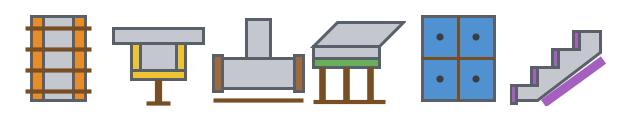
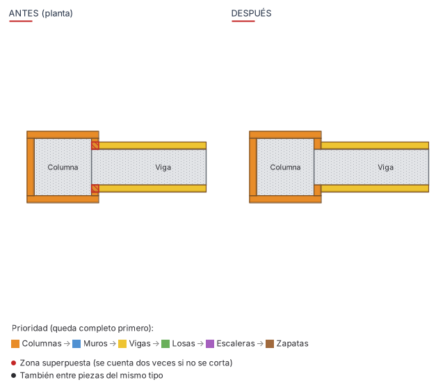
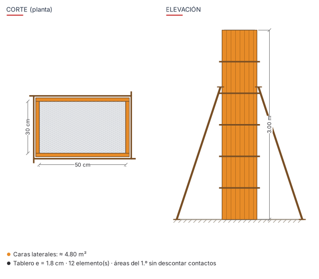
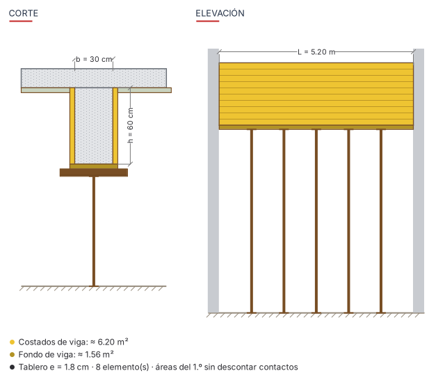
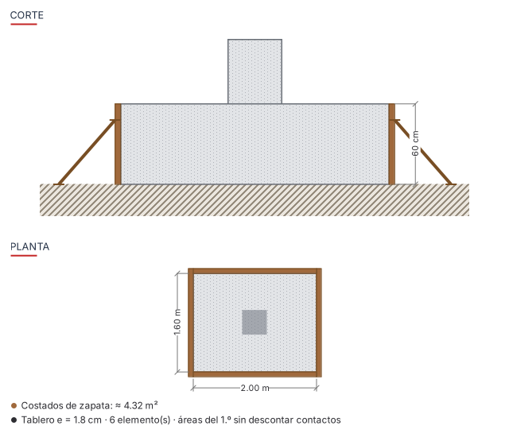
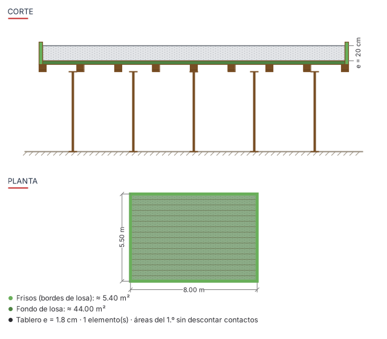
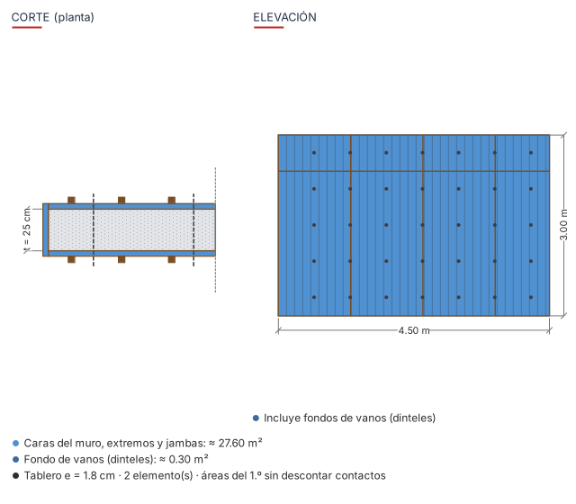
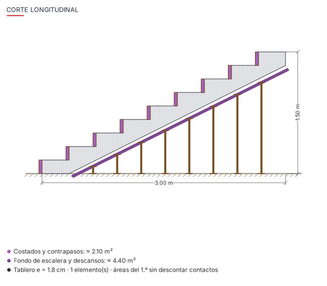
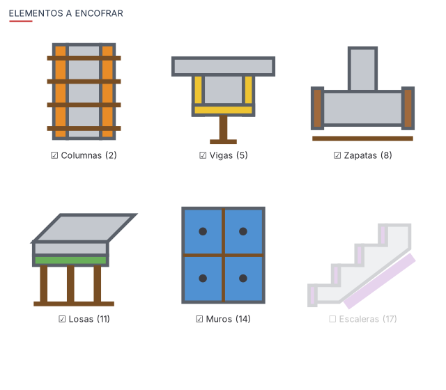

# ENCOFRADO para Revit 2024 – 2027

Complemento (add-in) en **C#** que genera los **tableros de encofrado** de una edificación de concreto armado y su **metrado en m²**.
Funciona desde una pestaña propia llamada **ENCOFRADO**.

Cada botón tiene su figurita en la cinta:



| Botón | Qué hace |
|---|---|
| **Encofrado Columna** | Caras laterales: rectangulares, **circulares** e **irregulares** (L, T, cruz, polígonos) |
| **Encofrado Viga** | Costados y fondo de viga |
| **Encofrado Zapata** | Costados: zapatas aisladas, cimientos corridos y losas de cimentación |
| **Encofrado Losa** | Fondo de losa y frisos (bordes y aberturas) |
| **Encofrado Muro** | Ambas caras, extremos, jambas y fondos de vanos (dinteles) |
| **Encofrado Escalera** | Fondo (losa inclinada y descansos), costados y contrapasos |
| **Encofrar todo** | Todos los elementos de la vista activa o del proyecto, de una vez |
| **Cortar intersecciones** | Recorta las zonas donde se superponen tableros de elementos vecinos |
| **Seleccionar** | Menú para seleccionar el encofrado ya generado: de columnas, de vigas, de zapatas, de losas, de muros, de escaleras o todo |
| **Metrado** | Tabla de planificación en Revit y archivo CSV para Excel |
| **Mostrar/Ocultar** | Alterna la visibilidad del encofrado en la vista activa |
| **Eliminar** | Borra el encofrado de los elementos seleccionados, o de todo el proyecto |

Los botones de cada elemento (columna, viga, zapata, losa, muro, escalera) funcionan igual:
pulse el botón, seleccione los elementos y pulse **Finalizar**. También puede seleccionar los elementos antes de pulsar el botón.

Cada ventana muestra la **figura del elemento** con sus tableros, puntales, yugos, barrotes o estacas.
La figura cambia según las caras elegidas y muestra el área aproximada a encofrar.

## Cómo calcula
1. Lee la geometría real de cada elemento y clasifica sus caras:
   - verticales: costados, frisos, contrapasos;
   - inferiores: fondos;
   - superiores: no se encofran.
2. Extruye cada cara hacia afuera con el **espesor del tablero** (1.8 cm por defecto). Las caras cilíndricas se extruyen como un anillo.
3. **Descuenta las zonas en contacto** con otros elementos (columnas, vigas, losas, muros, zapatas, escaleras):
   - el fondo de losa no se cuenta sobre las vigas y muros;
   - el extremo de una viga no se cuenta dentro de la columna;
   - la base de muros y escaleras no lleva encofrado.
4. Crea los tableros como **Modelo genérico**: una pieza por elemento y tipo de cara, con un color por tipo de elemento.
   Cada pieza lleva los parámetros compartidos `ENC_Elemento`, `ENC_Cara`, `ENC_Area`, `ENC_Nivel` y `ENC_IdElemento`.
5. Al volver a ejecutar, reemplaza el encofrado anterior de esos elementos. Así no se duplica.
6. Corta las intersecciones con el encofrado vecino. Se puede desactivar.

Opciones:
- *Solo concreto vaciado en obra* omite elementos de acero, madera y prefabricados.
- *Solo muros estructurales* omite la tabiquería.

## Cortar intersecciones
Cada elemento se encofra por separado, así que en las uniones dos tableros pueden ocupar el mismo espacio.
Pasa en la esquina columna-viga, viga-losa, y en los muros en L o T. Esas zonas se contarían dos veces en el metrado.

El botón **Cortar intersecciones** las recorta:
- El encofrado de **mayor prioridad queda completo**, y al de menor prioridad se le resta la parte superpuesta.
- Prioridad por defecto: columnas → muros → vigas → losas → escaleras → zapatas. Hay otros órdenes para elegir.
- Puede revisar todo el encofrado del proyecto o solo el seleccionado. Si selecciona elementos estructurales, se toma su encofrado.
- Opcionalmente corta también entre piezas del mismo tipo, como vigas que se cruzan o muros en L o T.
- El área `ENC_Area` de cada pieza cortada se recalcula, así el metrado queda correcto.

Al generar encofrado, la opción **"Cortar intersecciones entre encofrados al terminar"** viene activada por defecto: hace este corte automáticamente.



## Metrado
El botón **Metrado** crea la tabla **"ENCOFRADO - Metrado"**:
- agrupada por elemento y por cara (con el nivel y el Id de cada elemento);
- con subtotales y total general en m².

Además guarda un **CSV** en *Documentos*, separado por `;` para abrirlo directo en Excel, con el detalle y un resumen.

## Figuras

| Columna | Viga |
|---|---|
|  |  |

| Zapata | Losa |
|---|---|
|  |  |

| Muro | Escalera |
|---|---|
|  |  |

| Encofrar todo |
|---|
|  |

## Versiones de Revit

El mismo código se compila para cada versión de Revit, porque Revit cambió de plataforma .NET:

| Revit | Plataforma |
|---|---|
| 2024 | .NET Framework 4.8 |
| 2025 y 2026 | .NET 8 |
| 2027 | .NET 10 |

## Instalación

### Opción A: descargar el complemento ya compilado
1. En GitHub, abra **Actions → Compilar ENCOFRADO → la última ejecución**.
2. Descargue el artefacto de su versión, por ejemplo `Encofrado-Revit2025`.
3. Copie su contenido en `%AppData%\Autodesk\Revit\Addins\2025\` para que quede así:
   ```
   Addins\2025\Encofrado.addin
   Addins\2025\Encofrado\Encofrado.dll
   ```
4. Abra Revit y acepte **Cargar siempre** cuando aparezca el aviso de seguridad.

### Opción B: compilar usted mismo
Necesita el [SDK de .NET 8](https://dotnet.microsoft.com/download), y además el SDK de .NET 10 para Revit 2027.
No hace falta tener Revit instalado para compilar: las referencias de la API se descargan de NuGet.

```powershell
.\build.ps1                    # compila 2024, 2025, 2026 y 2027 en .\dist
.\install.ps1                  # copia a las versiones de Revit instaladas
```

Para una sola versión: `.\build.ps1 -Versions 2025` y `.\install.ps1 -Versions 2025`.
También puede abrir `Encofrado.sln` en Visual Studio 2022. La versión de Revit se elige con la propiedad `RevitVersion`, que por defecto es 2025.

## Uso
1. Pulse el botón del elemento, o seleccione antes los elementos.
2. Elija las caras a encofrar y el espesor del tablero.
3. Pulse **Generar encofrado**. Al final verá un resumen con los m² por elemento y cara.
4. Si generó elementos por separado o con el corte desactivado, pulse **Cortar intersecciones**.
5. Pulse **Metrado** para ver la tabla y exportar el CSV.

El programa recuerda los últimos valores de cada ventana en `%AppData%\ENCOFRADO`.

## Estructura del código

```
src/Encofrado/
  App.cs                    Pestaña ENCOFRADO y botones con sus íconos
  Commands/                 Comandos por elemento, encofrar todo, cortar intersecciones, seleccionar, metrado, mostrar/ocultar, eliminar
  Core/                     Reglas por elemento, tableros (extrusión + descuento de contactos), corte de intersecciones, parámetros, metrado
  UI/                       Ventana de datos con figura, dibujo, figuras del encofrado e íconos
```

Para agregar otro elemento estructural, agregue un valor a `Pieza` y sus reglas en `Piezas` (`Core/Pieza.cs`).

## Limitaciones
- Caras curvas que no sean cilindros verticales (por ejemplo, vigas curvas) se omiten; se avisa en el resumen.
- El área es la de contacto con el concreto. No incluye desperdicio, puntales ni andamios.
